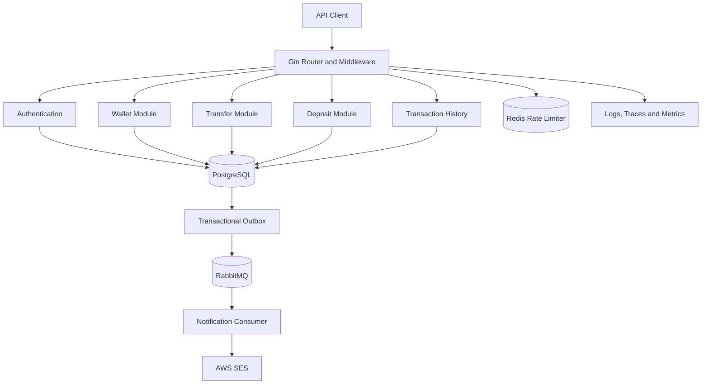

# LedgerX — Digital Wallet & Double-Entry Ledger Engine

A backend-focused digital wallet and ledger system built with Go, Gin, and PostgreSQL. LedgerX demonstrates financial transaction processing, double-entry accounting, idempotency, asynchronous messaging, rate limiting, database migrations, observability, containerization, and continuous integration.

<p align="center">

**Go · Gin · PostgreSQL · Redis · RabbitMQ · Docker · GitHub Actions**

</p>

<p align="center">

[Live API](https://digital-wallet-ledger-n4mn.onrender.com) ·
[API Documentation](https://digital-wallet-ledger-n4mn.onrender.com/swagger/index.html) ·
[GitHub Repository](https://github.com/Ritik-x/digital-wallet-ledger)

</p>

---

## Table of Contents

- [Overview](#overview)
- [Features](#features)
- [Architecture](#architecture)
- [Technology Stack](#technology-stack)
- [Financial Data Model](#financial-data-model)
- [API Reference](#api-reference)
- [Getting Started](#getting-started)
- [Environment Configuration](#environment-configuration)
- [Running with Docker Compose](#running-with-docker-compose)
- [Database Migrations](#database-migrations)
- [Running Tests and Checks](#running-tests-and-checks)
- [CI Pipeline](#ci-pipeline)
- [Deployment](#deployment)
- [Observability and Health Checks](#observability-and-health-checks)
- [Security Considerations](#security-considerations)
- [Project Structure](#project-structure)
- [Future Improvements](#future-improvements)
- [License](#license)

## Overview

LedgerX is a digital wallet backend designed to explore the engineering challenges behind financial systems.

Unlike a simple wallet implementation that stores a mutable balance, LedgerX uses a ledger-oriented model to record financial movements. This makes transaction history, reversals, and balance calculations central to the system.

The application separates HTTP handlers, business services, and repositories to keep transport concerns, business rules, and persistence logic independent.

The project also incorporates supporting infrastructure for asynchronous notification processing, API rate limiting, request observability, and repeatable database migrations.

**Project goals**

- Model financial transactions using double-entry accounting.
- Keep related financial database changes atomic.
- Make mutation requests safer to retry using idempotency.
- Support transaction reversal workflows rather than silently editing financial history.
- Process notification work asynchronously.
- Apply authentication and rate limiting to API requests.
- Package and deploy the backend using modern development workflows.

> **Disclaimer:** LedgerX is an educational portfolio project. It is not a production-ready banking or payment platform and has not been independently audited for financial, security, or regulatory compliance.

## Features

### Wallet management

- Create wallets for authenticated users.
- Support multiple wallets and currencies through the wallet and ledger data model.
- Retrieve a wallet's balance from ledger records.
- Keep financial records in PostgreSQL.

### Double-entry ledger

- Represent financial movements with debit and credit entries.
- Use ledger accounts to distinguish wallet accounts from system accounts.
- Maintain related financial changes within database transactions.
- Preserve transaction history for auditing and reconciliation.
- Model reversals as separate financial operations.

### Transfers and deposits

- Create wallet transfer requests.
- Create deposit requests through a mock payment-provider workflow.
- Support transfer reversal and deposit reversal operations.
- Integrate a mock payment webhook protected by a shared-secret signature.
- Use idempotency support for applicable mutation operations.

### Authentication and access control

- User registration and login.
- JWT-based authentication for protected endpoints.
- Role information for access-control workflows.
- Middleware-based authentication enforcement.

### Asynchronous messaging

- RabbitMQ integration for notification processing.
- A durable notification queue.
- A transactional outbox publisher to relay committed database events to RabbitMQ.
- An asynchronous consumer for notification processing.
- AWS Simple Email Service (SES) integration for email delivery.

The outbox pattern helps prevent a database change from being committed while its corresponding message is simply lost before publication. Delivery and retry behavior still need to be evaluated against the application's operational requirements.

### Rate limiting

- Redis-backed rate limiting.
- Separate middleware policies for authentication and protected API requests.
- A default policy of 10 authentication requests per minute and 100 protected API requests per minute.

These are application-level defaults, not a guarantee of a particular throughput or a complete distributed denial-of-service defense.

### Observability

- Structured request logging.
- OpenTelemetry instrumentation for Gin.
- Prometheus-compatible metrics endpoint.
- API and database health endpoints.

### Development and delivery

- Docker-based application image.
- Docker Compose configuration for local infrastructure.
- Versioned SQL migrations.
- GitHub Actions CI for formatting, dependency download, tests, static analysis, API compilation, and Docker image building.
- Deployment on Render.

## Architecture

LedgerX follows a modular backend architecture.



### Request flow

1. The client sends an HTTP request to the Gin API.
2. Middleware applies request handling, authentication where required, rate limiting, and observability.
3. The relevant handler validates and forwards the request to its service.
4. The service applies business rules and invokes the repository.
5. The repository interacts with PostgreSQL.
6. For supported asynchronous workflows, committed outbox events are published to RabbitMQ.
7. A consumer processes notification work separately from the original HTTP request.

### Separation of responsibilities

| Layer      | Responsibility                                          |
| ---------- | ------------------------------------------------------- |
| Handler    | HTTP input, response formatting, status codes           |
| Service    | Business rules and workflow coordination                |
| Repository | Database operations and persistence                     |
| Middleware | Authentication, rate limiting, request instrumentation  |
| Messaging  | Outbox publishing and asynchronous consumption          |
| Database   | Durable financial records and transactional consistency |

## Technology Stack

| Technology     | Purpose                                       |
| -------------- | --------------------------------------------- |
| Go             | Backend implementation                        |
| Gin            | HTTP routing and middleware                   |
| PostgreSQL     | Relational storage and financial transactions |
| Redis          | Rate limiting                                 |
| RabbitMQ       | Asynchronous message delivery                 |
| AWS SES        | Email notification delivery                   |
| Docker         | Containerization                              |
| Docker Compose | Local infrastructure orchestration            |
| GitHub Actions | Continuous integration                        |
| Render         | Application hosting                           |
| OpenTelemetry  | Request tracing instrumentation               |
| Prometheus     | Metrics exposition                            |
| Swagger        | Interactive API documentation                 |

## Financial Data Model

### Double-entry accounting

The core accounting principle is that each balanced financial transaction has equal total debits and credits.

\[
\text{Total Debits}=\text{Total Credits}
\]

For example, consider a transfer of ₹500 from Wallet A to Wallet B.

| Ledger account | Entry type   |             Amount |
| -------------- | ------------ | -----------------: |
| Wallet A       | Debit        |               ₹500 |
| Wallet B       | Credit       |               ₹500 |
| **Total**      | **Balanced** | **₹500 each side** |

This example illustrates the accounting invariant; actual posting directions depend on the account model and the specific transaction type.

### Why use a ledger?

A mutable balance alone cannot adequately explain how a wallet reached its current value. Ledger entries provide a record of financial movements that can be queried, reviewed, and reconciled.

LedgerX derives balances from ledger activity rather than treating a client-provided balance as authoritative.

### Transactional consistency

Related ledger changes should be committed atomically:

1. Validate the transfer and its business constraints.
2. Begin a database transaction.
3. Lock or otherwise safely coordinate the relevant account records where required.
4. Create the corresponding ledger entries.
5. Persist the associated transaction state and supported outbox event.
6. Commit the database transaction.

If a required operation fails, the transaction should roll back instead of leaving a partially posted transfer.

### Idempotency

Network failures can cause clients to retry a request even when the original request reached the server.

An idempotency mechanism allows supported operations to recognize a repeated request and avoid creating a second financial operation. Correct behavior depends on how the key, request payload, operation state, and stored response are handled.

### Reversals

A reversal should record a compensating financial operation rather than silently deleting or rewriting the original ledger entries. This preserves the transaction history and makes the resulting financial activity easier to audit.

## API Reference

The base API path is `/api/v1`.

### Health and operational endpoints

| Method | Endpoint              | Purpose                     |
| ------ | --------------------- | --------------------------- |
| `GET`  | `/health`             | Check API health            |
| `GET`  | `/health/db`          | Check database connectivity |
| `GET`  | `/metrics`            | Expose application metrics  |
| `GET`  | `/swagger/index.html` | Open Swagger UI             |

### Authentication

| Method | Endpoint                | Purpose             |
| ------ | ----------------------- | ------------------- |
| `POST` | `/api/v1/auth/register` | Register a user     |
| `POST` | `/api/v1/auth/login`    | Authenticate a user |

### Wallets and transactions

These endpoints require authentication.

| Method | Endpoint                           | Purpose                             |
| ------ | ---------------------------------- | ----------------------------------- |
| `POST` | `/api/v1/wallets`                  | Create a wallet                     |
| `GET`  | `/api/v1/wallets/:id/balance`      | Retrieve a wallet balance           |
| `GET`  | `/api/v1/wallets/:id/transactions` | Retrieve wallet transaction history |
| `POST` | `/api/v1/transfers`                | Initiate a transfer                 |
| `POST` | `/api/v1/transfers/:id/reverse`    | Reverse a transfer                  |
| `POST` | `/api/v1/deposits`                 | Initiate a deposit                  |
| `POST` | `/api/v1/deposits/:id/reverse`     | Reverse a deposit                   |

### Payment webhook

| Method | Endpoint                        | Purpose                                 |
| ------ | ------------------------------- | --------------------------------------- |
| `POST` | `/api/v1/webhooks/mock-payment` | Receive a mock payment-provider webhook |

The webhook uses a configured shared secret to verify the incoming signature. Consult the implementation and Swagger documentation for the exact request body and signature format.

### Authentication example

After registering or logging in, use the returned access token for protected requests:

```http
Authorization: Bearer <access_token>
```

For example, to check the health of the deployed API:

```bash
curl https://digital-wallet-ledger-n4mn.onrender.com/health
```

To check database connectivity:

```bash
curl https://digital-wallet-ledger-n4mn.onrender.com/health/db
```

For mutation requests, follow the request schema documented in Swagger and supply the required idempotency header where the endpoint's implementation supports it.

## Getting Started

### Prerequisites

Install the following tools:

- Go compatible with the version specified in `go.mod`
- Docker Desktop or Docker Engine with the Compose plugin
- Git

For a local run, PostgreSQL, Redis, RabbitMQ, and the required AWS SES configuration must also be available. Docker Compose can start the local database and messaging infrastructure.

### 1. Clone the repository

```bash
git clone https://github.com/Ritik-x/digital-wallet-ledger.git
cd digital-wallet-ledger
```

### 2. Configure environment variables

Create a `.env` file in the repository root. Use the configuration section below as a starting point and replace the example secrets with unique values.

Never commit real credentials, production URLs containing credentials, or private keys.

### 3. Start the application

The recommended local path is Docker Compose, which builds the API and migration images and starts the supporting services.

```bash
docker compose up --build
```

Compose is configured to run database migrations after PostgreSQL becomes healthy and before starting the API.

The API is exposed locally at:

```text
http://localhost:8081
```

Check its health:

```bash
curl http://localhost:8081/health
```

Check the database connection:

```bash
curl http://localhost:8081/health/db
```

Open the API documentation:

```text
http://localhost:8081/swagger/index.html
```

### 4. Stop the services

```bash
docker compose down
```

To remove the persistent local database, Redis, and RabbitMQ volumes as well, use:

```bash
docker compose down -v
```

**Warning:** The `-v` option deletes the Compose-managed persistent data. Do not use it if you need to preserve local database records.

## Environment Configuration

The application requires database, JWT, webhook, Redis, RabbitMQ, and notification configuration.

Example `.env` for local development:

```dotenv
# PostgreSQL
DB_HOST=postgres
DB_PORT=5432
DB_USER=ledgerx
DB_PASSWORD=replace_with_a_strong_local_password
DB_NAME=ledgerx
DB_SSLMODE=disable

# JWT authentication
JWT_SECRET=replace_with_a_random_secret_at_least_32_characters

# Mock payment webhook verification
MOCK_PAYMENT_WEBHOOK_SECRET=replace_with_a_different_random_secret_at_least_32_characters

# Redis
REDIS_ADDR=redis:6379
REDIS_PASSWORD=
REDIS_DB=0

# RabbitMQ
RABBITMQ_PASSWORD=replace_with_a_strong_local_password
RABBITMQ_QUEUE=ledgerx-notifications

# API server
PORT=8080

# AWS SES
AWS_REGION=replace_with_your_aws_region
```

This is an example configuration, not a complete production secret-management policy. The Docker Compose file overrides the database host, Redis address, RabbitMQ URL, and API port for its internal network.

For local AWS SES integration, configure credentials through an AWS-supported credential provider, such as your local AWS profile or environment credentials. Do not put production credentials into source control.

### Environment variable reference

| Variable                      | Purpose                                             |
| ----------------------------- | --------------------------------------------------- |
| `DB_HOST`                     | PostgreSQL hostname                                 |
| `DB_PORT`                     | PostgreSQL port                                     |
| `DB_USER`                     | Database username                                   |
| `DB_PASSWORD`                 | Database password                                   |
| `DB_NAME`                     | Database name                                       |
| `DB_SSLMODE`                  | PostgreSQL TLS mode                                 |
| `JWT_SECRET`                  | JWT signing secret; at least 32 characters          |
| `MOCK_PAYMENT_WEBHOOK_SECRET` | Webhook verification secret; at least 32 characters |
| `REDIS_ADDR`                  | Redis host and port                                 |
| `REDIS_PASSWORD`              | Redis password, if required                         |
| `REDIS_DB`                    | Redis database index                                |
| `RABBITMQ_URL`                | RabbitMQ connection URL                             |
| `RABBITMQ_QUEUE`              | Durable notification queue name                     |
| `RABBITMQ_PASSWORD`           | Local RabbitMQ password used by Compose             |
| `PORT`                        | HTTP port; defaults to `8080`                       |
| `AWS_REGION`                  | AWS region used for notification delivery           |

The exact deployment configuration can vary by hosting provider. Configure secrets in the hosting environment rather than committing them to `.env` files.

## Running with Docker Compose

The repository's Compose configuration defines the following services:

| Service    | Purpose                |
| ---------- | ---------------------- |
| `postgres` | PostgreSQL database    |
| `redis`    | Rate-limit storage     |
| `rabbitmq` | Message broker         |
| `migrate`  | Applies SQL migrations |
| `api`      | LedgerX HTTP API       |

Start all services:

```bash
docker compose up --build
```

Run in the background:

```bash
docker compose up --build -d
```

View service status:

```bash
docker compose ps
```

View API logs:

```bash
docker compose logs -f api
```

View migration logs:

```bash
docker compose logs migrate
```

Stop services:

```bash
docker compose down
```

## Database Migrations

SQL migrations are maintained in the `migrations/` directory and are versioned using sequential migration filenames.

The project uses migrations to evolve the database schema reproducibly, including changes for ledger accounts, deposits, idempotency, reversals, user roles, outbox events, and deposit status.

With Docker Compose, the migration service applies the migrations automatically during startup.

If you need to run migrations separately, use a compatible version of the `golang-migrate` CLI and point it at the correct database:

```bash
migrate -path migrations -database "$DATABASE_URL" up
```

Here, `DATABASE_URL` must be set to a valid migration connection string for the target database. Use the correct SSL mode for the environment.

**Important:** Back up important data before applying schema changes to a database containing records you need to retain. Do not run local-development migration settings against production accidentally.

## Running Tests and Checks

Run the following commands from the repository root.

### Format check

```bash
test -z "$(gofmt -l .)"
```

Format Go source files:

```bash
gofmt -w .
```

### Download dependencies

```bash
go mod download
```

### Run Go tests

```bash
go test ./...
```

### Run static analysis

```bash
go vet ./...
```

### Build the API

```bash
go build ./cmd/api
```

### Build the Docker image

```bash
docker build -t ledgerx-ci .
```

The current Go test run reports packages with `[no test files]` where automated test files are not present. Successful package compilation is useful, but it is not a substitute for comprehensive automated tests of financial invariants, authorization, idempotency, concurrent transfers, and failure recovery.

## CI Pipeline

LedgerX uses GitHub Actions to validate changes pushed to `main` and pull requests targeting `main`.

Workflow file:

```text
.github/workflows/ci.yml
```

The pipeline checks:

1. Checkout of the repository.
2. Go toolchain setup from `go.mod`.
3. Go formatting.
4. Dependency download.
5. Go test execution.
6. `go vet` static analysis.
7. API build.
8. Docker image build.

View workflow runs:

[GitHub Actions — LedgerX](https://github.com/Ritik-x/digital-wallet-ledger/actions)

A successful CI run confirms that the configured checks passed for that commit. It does not by itself prove complete financial correctness, security, or performance.

## Deployment

LedgerX is deployed on Render.

- **Live API:** https://digital-wallet-ledger-n4mn.onrender.com
- **Health endpoint:** https://digital-wallet-ledger-n4mn.onrender.com/health
- **Database health:** https://digital-wallet-ledger-n4mn.onrender.com/health/db
- **Swagger UI:** https://digital-wallet-ledger-n4mn.onrender.com/swagger/index.html

The deployment uses a Docker-based service and external managed infrastructure for PostgreSQL, Redis, and RabbitMQ.

### Production configuration checklist

Before deploying to a production environment:

- Configure all required secrets in the hosting provider's environment settings.
- Use TLS for external database and broker connections.
- Apply database migrations through a controlled release process.
- Restrict access to metrics and operational endpoints as appropriate.
- Configure database backups and recovery procedures.
- Monitor application logs, traces, queue health, and database connections.
- Verify idempotency and concurrency behavior under realistic load.
- Test webhook signature validation and replay protection.
- Confirm notification retries, failure handling, and outbox recovery.
- Establish a deployment strategy that only releases commits after CI succeeds.

The existing CI workflow validates code and builds the Docker image. Deployment gating is a separate concern and should not be assumed unless explicitly configured.

## Observability and Health Checks

### API health

```bash
curl https://digital-wallet-ledger-n4mn.onrender.com/health
```

This endpoint returns the API's health status and instance identifier.

### Database health

```bash
curl https://digital-wallet-ledger-n4mn.onrender.com/health/db
```

This endpoint checks database connectivity and returns an error status if PostgreSQL is unavailable.

### Metrics

```text
GET /metrics
```

The metrics endpoint exposes application metrics in a Prometheus-compatible format.

### Tracing and logging

The application integrates OpenTelemetry middleware with Gin and uses structured request logging. These components provide a foundation for investigating request behavior and diagnosing service issues.

Actual trace collection and visualization depend on the configured telemetry exporter and backend.

## Security Considerations

Financial applications require careful treatment of authentication, authorization, retries, and data integrity.

LedgerX includes several foundational controls:

- JWT authentication on protected routes.
- Redis-backed request rate limiting.
- A minimum-length check for JWT and webhook secrets.
- Shared-secret webhook signature verification.
- PostgreSQL transactions for related financial writes.
- Idempotency support for applicable mutation workflows.
- Reversal workflows that preserve transaction history.

These controls are foundations, not a certification of production security.

Further work should include comprehensive role enforcement tests, authorization checks for wallet ownership, replay protection, secret rotation, input validation, dependency scanning, audit logging, and adversarial testing. A real financial deployment also requires operational controls and appropriate regulatory review.

## Project Structure

```text
digital-wallet-ledger/
├── .github/
│   └── workflows/
│       └── ci.yml
├── cmd/
│   ├── api/
│   └── mock-provider/
├── config/
│   └── nginx/
├── docs/
├── internal/
│   ├── auth/
│   ├── database/
│   ├── deposit/
│   ├── history/
│   ├── messaging/
│   ├── notification/
│   ├── observability/
│   ├── ratelimit/
│   ├── transfer/
│   └── wallet/
├── migrations/
├── Dockerfile
├── Dockerfile.migrate
├── compose.yaml
├── go.mod
├── go.sum
├── prometheus.yml
└── README.md
```

### Key directories

- `cmd/api/` — API entry point and application wiring.
- `cmd/mock-provider/` — mock payment-provider utility.
- `internal/auth/` — authentication and user persistence.
- `internal/wallet/` — wallet operations.
- `internal/transfer/` — transfers and reversal workflows.
- `internal/deposit/` — deposits, webhooks, and deposit reversals.
- `internal/history/` — transaction history queries.
- `internal/messaging/` — RabbitMQ integration and outbox processing.
- `internal/notification/` — email notification integration.
- `internal/ratelimit/` — Redis-backed rate limiting.
- `internal/observability/` — logging, metrics, and tracing.
- `internal/database/` — database connection management.
- `migrations/` — versioned database schema changes.
- `.github/workflows/` — CI automation.

## Future Improvements

Potential next steps include:

- Add automated unit and integration tests for financial invariants.
- Add concurrent-transfer tests to validate account locking and consistency.
- Add fault-injection tests for database, Redis, and RabbitMQ failures.
- Improve idempotency response persistence and conflict handling.
- Implement and test a complete retry, dead-letter, and replay strategy for asynchronous messages.
- Add CI-gated deployment so a failed workflow cannot release a commit.
- Add dependency vulnerability scanning and security checks.
- Add load tests and document measured throughput and latency.
- Improve operational dashboards, alerts, and reconciliation reporting.
- Add documented API request and response examples generated from the actual schemas.

## License

No license has been specified yet. Unless a license is added to the repository, reuse and redistribution are subject to the applicable copyright rules.

---

**Built as a backend engineering portfolio project to explore financial consistency, reliable transaction processing, asynchronous systems, and deployment workflows.**
